# Learnify

**Learn smarter. Grow faster.**

Modern Educational Platform built with React and TypeScript.

> **Learnify is a front-end-only educational platform built with mock data and browser-based persistence.**
> There is no backend, database, or real authentication. Everything runs in the browser, and all courses, people, reviews, and statistics are fictional demo data.

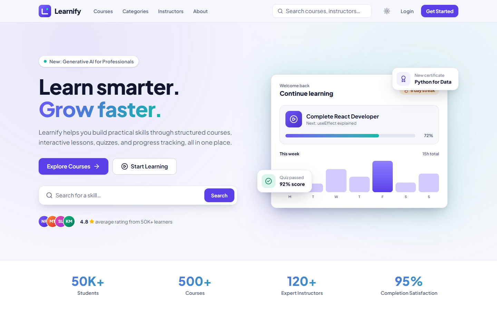

## Features

**Public website**

- Marketing landing page: hero with product preview, stats, popular courses, categories, "Why Learnify", top instructors, testimonials, CTA, and footer
- Course catalogue with live search, category chips, filters (level, rating, duration, price), five sort orders, and client-side pagination
- Course details: hero, "What you'll learn", requirements, expandable curriculum, instructor, star-filterable reviews, and a demo enrollment flow
- Categories, category pages, instructors, and instructor profiles
- Login and register with React Hook Form + Zod validation, a "Use Demo Account" shortcut, forgot-password modal, and "Remember me"

**Student application**

- Dashboard: greeting, stat cards, continue learning, weekly activity chart (Recharts), upcoming tasks, and recent achievements
- My Courses with All / In Progress / Completed / Saved tabs
- Learning page: curriculum sidebar (drawer on mobile), custom video-player UI, notes, resources, previous / next navigation, and **Mark as Complete** with persisted progress
- Quiz system: question navigator, answer selection, submit guard, timer, results screen, and a full answer review with explanations
- Certificates: polished certificate design, full-size viewer, and print / save as PDF (client-side)
- Achievements: ten badges with locked / unlocked state and live progress
- Profile editing and Settings (account, appearance, notifications, preferences)
- Notification center with mark as read, mark all as read, and delete

**Product details**

- Light, dark, and system themes, applied before first paint to avoid a flash
- Global search with debounced results, loading skeletons, empty state, keyboard navigation, and persisted recent searches
- Skeleton loading, empty states, and a reusable error state with retry (try appending `?simulate=error` to `/courses`, `/dashboard`, `/my-courses`, or a course page)
- Toast notifications, accessible modals and drawers (native `<dialog>`), menus, tabs, and switches

## Screenshots

| Dashboard (dark) | Course catalogue |
| --- | --- |
| 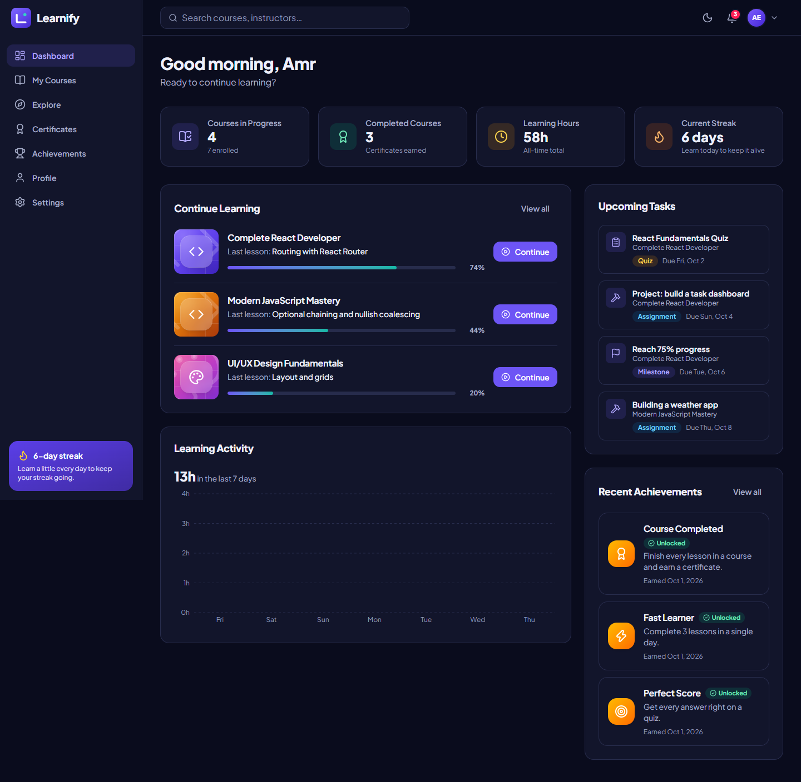 | 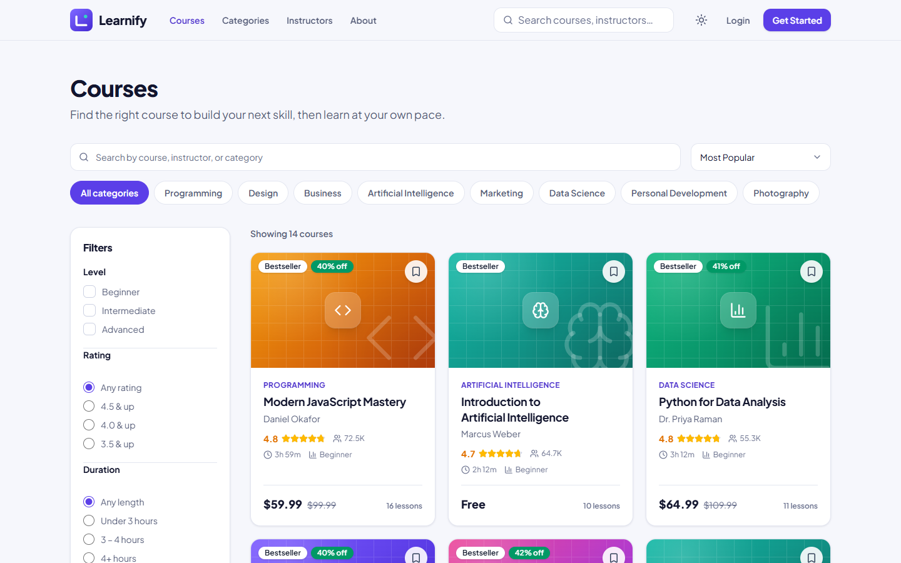 |

| Learning page (dark) | Quiz |
| --- | --- |
| 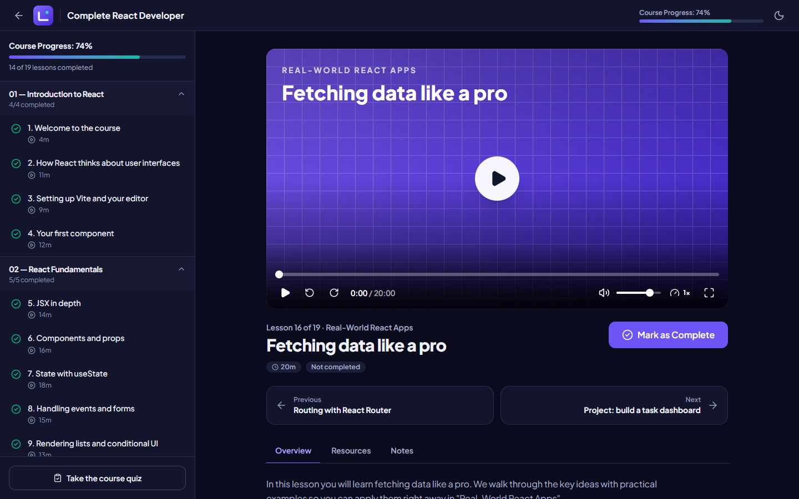 | 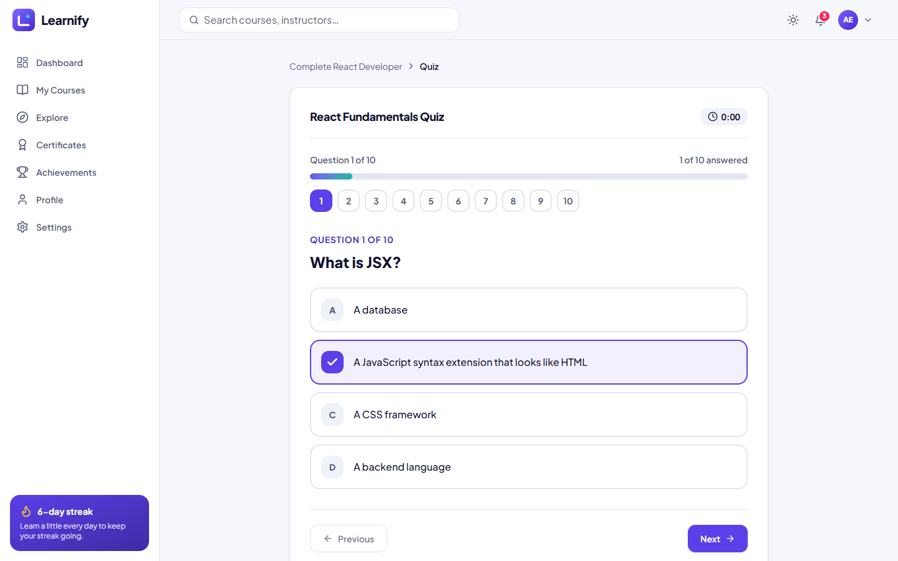 |

| Certificates | Course details |
| --- | --- |
| 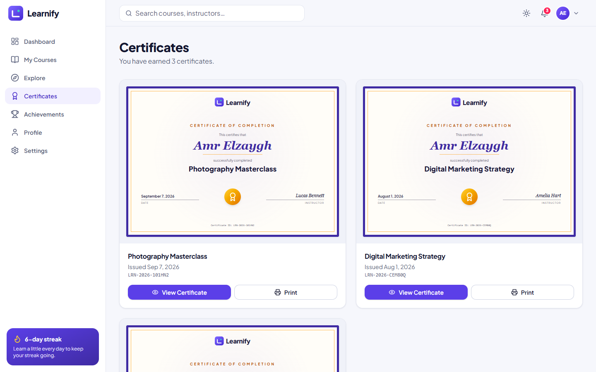 | 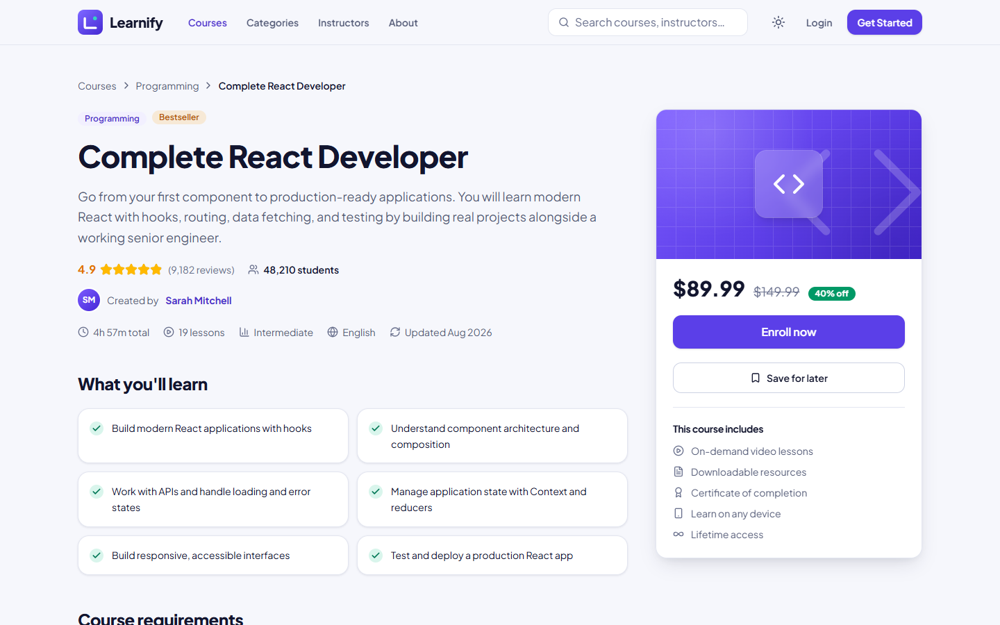 |

| Achievements | Profile |
| --- | --- |
| 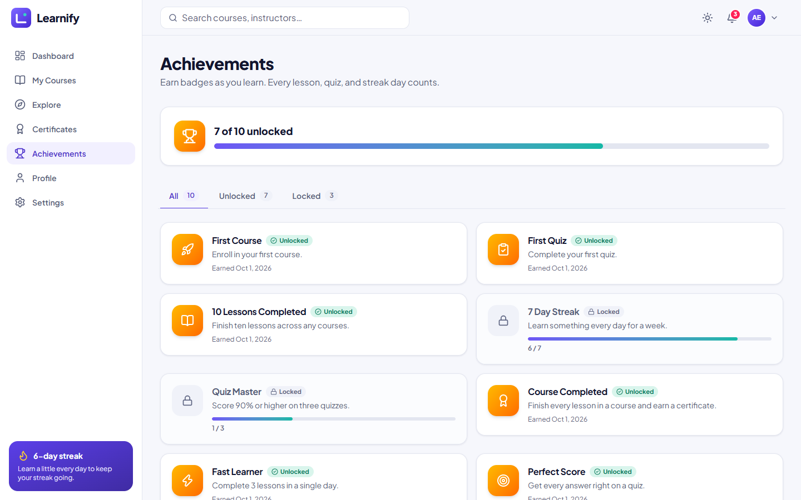 | 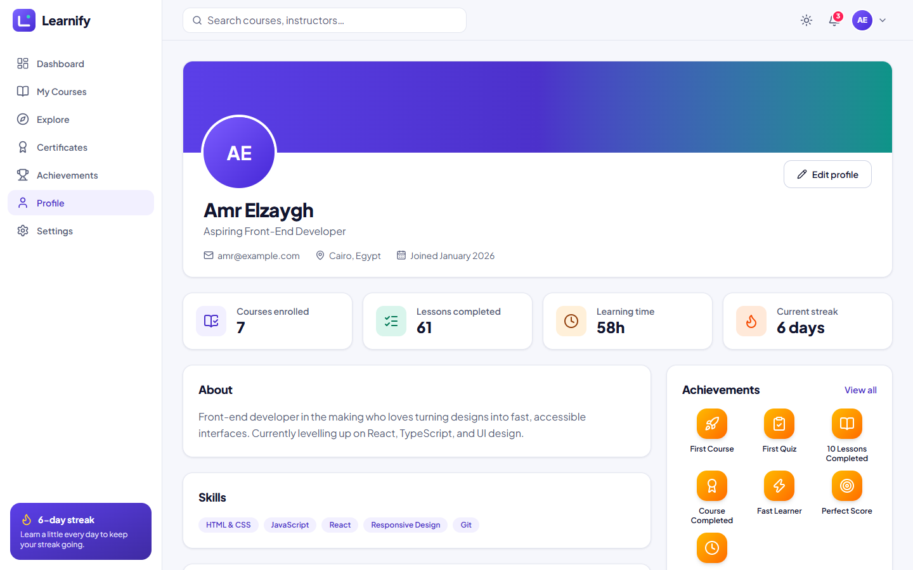 |

**Mobile**

| Home | Courses | Dashboard | Learning |
| --- | --- | --- | --- |
| 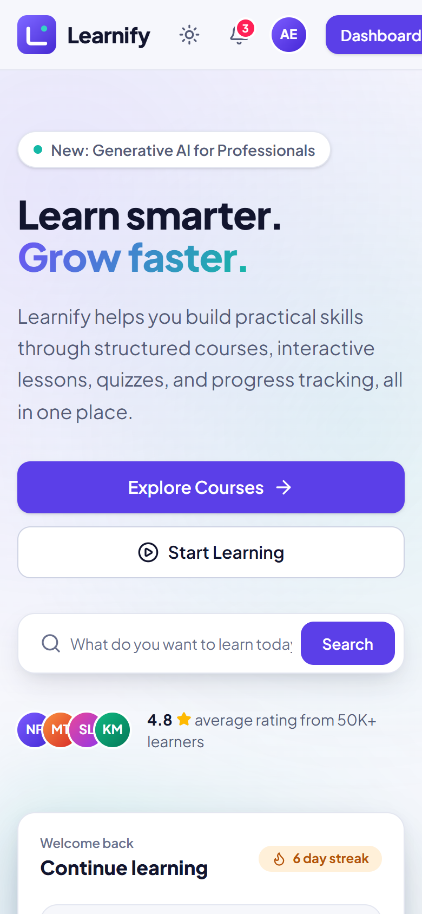 | 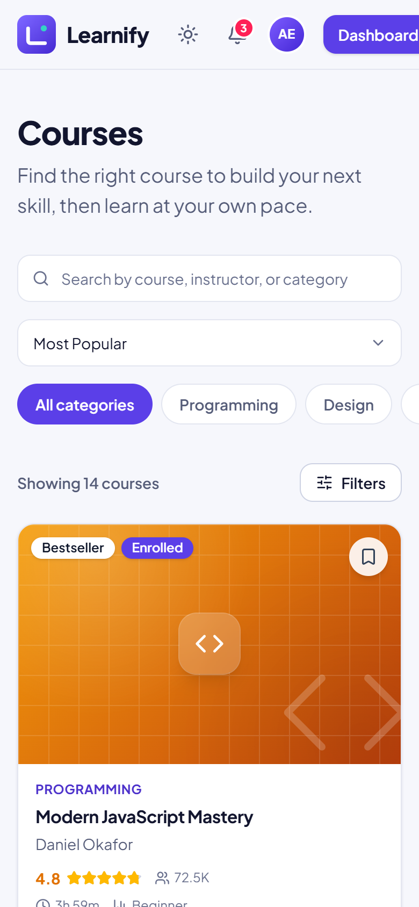 | 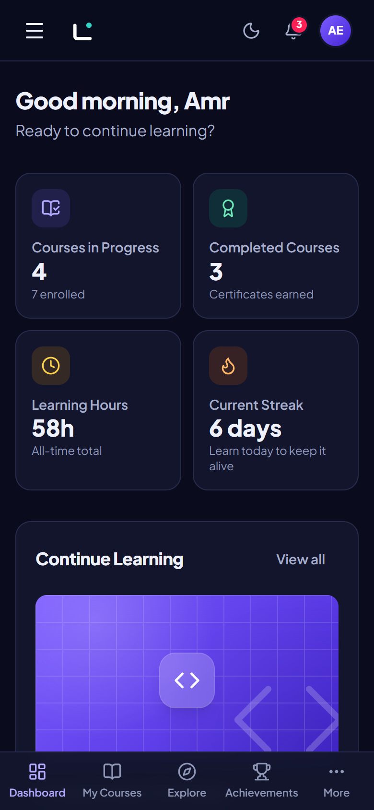 | 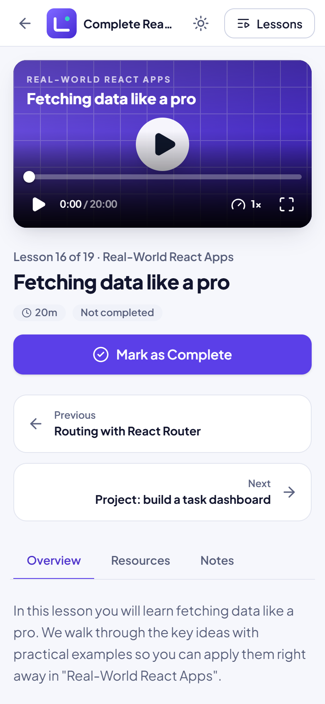 |

## Tech Stack

| Area | Choice |
| --- | --- |
| Framework | React 19, TypeScript (strict), Vite |
| Styling | Tailwind CSS v4 with a token-based design system (light + dark) |
| Routing | React Router v7 (data router, lazy-loaded routes) |
| State | Zustand (with `persist` middleware) |
| Forms | React Hook Form + Zod |
| Charts | Recharts |
| Icons | Lucide React |
| Dates | date-fns |
| Font | Plus Jakarta Sans (self-hosted via Fontsource) |
| Linting | oxlint |

No backend, no API server, no UI kit. Every dependency is used.

## Project Structure

```text
src/
├── components/
│   ├── common/        Button, Input, Modal, Drawer, Menu, Popover, Tabs, Badge, Avatar, Skeleton, ...
│   ├── course/        CourseCard, CourseGrid, CourseHeader, CourseCurriculum, CourseReviews, InstructorCard, ...
│   ├── learning/      VideoPlayer, LessonSidebar, LessonNavigation, ProgressBar, ResourceList, LessonNotes
│   ├── quiz/          QuizQuestion, QuizProgress, QuizNavigation, QuizResult, AnswerReview
│   ├── dashboard/     StatCard, ActivityChart, ContinueLearning, AchievementCard
│   ├── certificate/   CertificateView, CertificateCard
│   ├── search/        SearchBox, SearchPanel
│   └── ...            auth, home, notifications, profile, settings
├── data/              Typed mock data: courses, instructors, categories, lessons, quizzes, achievements, ...
├── hooks/             useDismiss, useSimulatedLoading
├── layouts/           PublicLayout, AuthLayout, AppLayout (sidebar, top bar, bottom tabs, drawer)
├── lib/               storage, search, filters, stats, achievements, seeding, schemas, session
├── pages/             One file per route, lazy-loaded
├── routes/            Router, route guards, root shell and error boundary
├── store/             Zustand stores (auth, course, progress, quiz, achievement, notification, settings, theme, search, toast)
├── types/             Shared TypeScript types
├── utils/             cn, date and format helpers
├── App.tsx
├── main.tsx
└── index.css          Design tokens (Tailwind @theme) and base styles
```

## Installation

```bash
git clone https://github.com/amroA12/Educational-Platform.git
cd Educational-Platform
npm install
npm run dev
```

Open the URL printed in the terminal (usually http://localhost:5173), then choose **Use Demo Account** on the login page to explore a populated student profile (Amr Elzaygh, `amr@example.com`). Any email with a password of 6+ characters also signs in, and **Register** creates an empty account so you can see empty states.

## Available Scripts

| Script | Description |
| --- | --- |
| `npm run dev` | Start the Vite dev server |
| `npm run build` | Type-check and create a production build in `dist/` |
| `npm run preview` | Preview the production build locally |
| `npm run typecheck` | Run the TypeScript compiler without emitting files |
| `npm run lint` | Lint the project with oxlint |

## Architecture

**Design system.** Tokens live in `src/index.css`. Raw scales (brand palette, radius, shadows, motion) are defined with Tailwind v4 `@theme`; semantic tokens (`bg-surface`, `text-fg-muted`, `border-line`, `bg-primary`, ...) are CSS variables that swap between light and dark. Components use the semantic names, so almost nothing needs a `dark:` variant and every page stays consistent.

**State.** Global state is limited to what is genuinely shared and persistent: `auth`, `courses` (favorites and enrollments), `progress` (completed lessons, last lesson, study log, notes), `quizzes`, `achievements`, `notifications`, `settings`, `theme`, and `recent-searches`. Everything else (filters, tabs, open dialogs, the quiz in progress) is local React state. A small subscription module (`lib/achievementSync.ts`) unlocks achievements and creates progress notifications in response to store changes, so gamification stays decoupled from the UI.

**Persistence.** `lib/storage.ts` is the only code that touches `localStorage`/`sessionStorage`. Every call is guarded for private mode and quota errors, and Zustand's `persist` middleware goes through the same namespaced adapter. "Remember me" decides whether the session lives in `localStorage` or `sessionStorage`.

| Key | Contents |
| --- | --- |
| `learnify:theme` | Light / dark / system |
| `learnify:auth` | Demo session and saved profiles (profile edits persist across sign-outs) |
| `learnify:courses` | Favorites and enrollments |
| `learnify:progress` | Completed lessons, last lesson, completion dates, study log, notes |
| `learnify:quizzes` | Every quiz attempt |
| `learnify:achievements` | Unlock dates |
| `learnify:notifications` | Notification center items |
| `learnify:settings` | Notification and learning preferences |
| `learnify:recent-searches` | Recent global searches |

**Demo data.** The demo student is seeded once, the first time the demo account signs in. Settings → Account → *Reset all local data* clears every key and starts over. Because there is no server, "network" latency is simulated with short delays (`lib/async.ts`, `hooks/useSimulatedLoading.ts`) so skeletons, loading buttons, and error states are part of the real UX.

**Routing.** Routes are lazy-loaded with a Suspense fallback. Three layouts (public, auth, app) and two guards (`RequireAuth`, `GuestOnly`) keep route definitions declarative. Unknown routes and runtime errors have dedicated UI.

**Generated visuals.** Course thumbnails, avatars, and the certificate are rendered with CSS and SVG, so the project has no remote images and works offline.

## Front-End Concepts Demonstrated

- Component architecture: small, reusable components (one `CourseCard` for every list, shared form field chrome, polymorphic button / link-button)
- TypeScript: strict mode, discriminated unions, typed stores, inferred form types from Zod schemas, no `any`
- State management: scoped Zustand stores, selectors that return primitives, derived data computed with `useMemo`
- Forms and validation: React Hook Form + Zod with accessible, inline error messages
- Routing: nested layouts, route guards with redirect-back, lazy loading, error boundary
- Responsive design: desktop sidebar vs. mobile bottom tab bar and drawers, filter drawer, mobile-first grids, tested at 375, 390, 768, 1024, 1280, and 1440 px
- Accessibility: semantic landmarks, labelled controls, visible focus, keyboard navigation (menus, tabs, search combobox, video player), `aria-live` toasts, native `<dialog>`, status shown with icons and text rather than colour alone, `prefers-reduced-motion` support
- Performance: route-level code splitting, memoized card component, derived selectors, no layout-shifting images
- Data visualisation: a themed Recharts bar chart with a screen-reader table alternative
- Local persistence: guarded storage layer, "remember me", seeded demo data, reset flow
- Gamification: achievements, streaks, and certificates derived from real learner activity

## Quality checks

During development the app was checked with the TypeScript compiler (strict), oxlint, an axe-core accessibility scan of every route in light and dark mode (no violations), an automated layout sweep for horizontal overflow at 375, 390, 768, 1024, 1280, and 1440 px, console-error monitoring, and scripted end-to-end flows covering search, filtering, enrollment, progress persistence, quizzes, notifications, theme, and profile editing.

## Future Improvements

- Real authentication and a backend API (the stores and `data/` layer are shaped to be swapped for API calls)
- Real video hosting with captions and transcripts
- Unit and component tests (Vitest and Testing Library) and Playwright end-to-end tests
- Internationalisation, including right-to-left layouts
- Instructor and admin dashboards
- Discussion threads and per-lesson comments
- Progressive Web App support for offline learning

## Author

**Amr Elzaygh**

- GitHub: [@amroA12](https://github.com/amroA12)

Released under the [MIT License](LICENSE).
